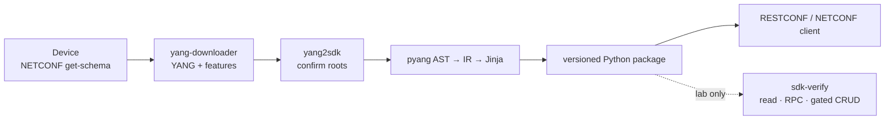

# yang2sdk

**From YANG to a typed Python SDK — without hand-written wrappers.**

Point `yang2sdk` at a network device, confirm the modules you care about, and get
a Pydantic v2 client that knows the device's real data model: strict models,
typed navigators, RPCs, and both RESTCONF and NETCONF transports.

[](https://github.com/ConsortiumGARR/yang2sdk/actions/workflows/ci-pr.yaml)
[](https://www.python.org/)
[](LICENSE)
[](docs/usage.md)

[Quick start](#quick-start) · [What you get](#what-you-get) · [Authentication](#authentication) · [Validation](#validation) · [Documentation](#documentation) · [Contributing](#contributing)

> [!WARNING]
> **Lab gear only for whole-tree reads.** Never request root `restconf/data/`
> on production — a large config can spike to 100% CPU and trigger a watchdog
> reboot or OOM kill. Read a subtree with an explicit `depth` (navigators
> default to `depth=2`); reserve `depth="unbounded"` for small lab trees.

## Why yang2sdk

Network automation breaks when the SDK and the device disagree. `yang2sdk`
removes the drift: the device supplies the YANG modules and feature set, the
generator compiles the augment closure, and the emitted client is a
self-contained package pinned to that device and OS version.

| | |
| --- | --- |
| **Device-derived** | Downloads the device's own YANG modules and capabilities, so the models describe what the box actually runs — not a generic vendor bundle. |
| **Typed end to end** | Pydantic v2 models with enums, constraints, aliases, strict validation, and RFC 7951 64-bit handling. Bad values fail in the IDE, not on the device. |
| **One navigator model** | RESTCONF and NETCONF expose the same intent — `retrieve` / `update` / `replace` / `create` / `delete` and RPC calls — with the protocol-appropriate verb set documented explicitly. |
| **Safe by default** | Strict models, host-key/TLS verification, `auto_commit=False`, and a `replace()` guard that refuses to silently delete unset fields. |
| **Verifiable** | `sdk-verify` walks the generated navigator tree and calls its own methods on a lab device, instead of trusting the wire shape by inspection. |
| **Publishable** | One installable package per device **and** OS version, with its own `pyproject.toml`, models, navigators, and provenance manifest. |

## How it works



## Quick start

Requires Python >= 3.12 and [`uv`](https://github.com/astral-sh/uv).

```bash
git clone https://github.com/ConsortiumGARR/yang2sdk.git
cd yang2sdk
uv sync --locked --extra lab
cp .env.example .env   # never commit .env
```

Set the target in `.env`: `DEVICE_NAME`, `DEVICE_VERSION`, `DEVICE_IP`,
`DEVICE_USER`, and either `DEVICE_PASS` or, for NETCONF,
`DEVICE_SSH_KEY` / `DEVICE_SSH_KEY_PASSPHRASE`.

```bash
uv run yang-downloader
uv run yang2sdk --protocol netconf   --device <device>
uv run yang2sdk --protocol restconf --device <device>
```

The compiler proposes root modules interactively; press Enter to accept them,
or pass `--roots <mod1>,<mod2>` to make the choice explicit. `temp/` is an
untracked workspace created on demand — removing it only loses re-downloadable
or recompilable output.

Optional: inspect the downloaded tree with `pyang` before compiling.

```bash
mkdir -p temp/yang_tree
uv run pyang -p temp/yang_modules/<device>/ -f tree \
  temp/yang_modules/<device>/*.yang > temp/yang_tree/<device>.txt
```

## What you get

Each compile emits a self-contained package at
`temp/<protocol>_clients/<device>_<os-version>/`:

```text
<device>_<os-version>/
  __init__.py                  # RestconfClient / NetconfClient
  session_manager.py           # transport and credentials
  data_models/
  data_navigators/             # client.data.<module>_<node>(...)
  pyproject.toml
  README.md
  MANIFEST.yang-revisions.json
  py.typed
```

Install it like any other dependency:

```bash
uv add path/to/temp/restconf_clients/<device>_<os-version>
```

```python
from <device>_<os_version> import RestconfClient  # or NetconfClient
```

One package per device **and** OS version: different YANG revisions produce
different models. See [the generated-package section](docs/usage.md#generated-package)
for the full layout and [the HAL sketch](docs/usage.md#scaling-to-production-hal)
for multi-vendor composition.

## Example

```python
from g30_1_4_0 import RestconfClient

# Credentials come from constructor args or the environment at runtime.
# Nothing is baked into generated code; verify=True is the default.
client = RestconfClient(management_ip="192.0.2.10")

# Top-level data is "<module>_<node>"; lists take key(s) in `key` order.
iface = client.data.ietf_interfaces_interface("ethernet-1/1")

port = iface.retrieve(content="config", depth=2)
port.description = "uplink-to-core"
iface.update(port)  # PATCH merge — the verb you normally want
```

Pydantic validates on assignment, so the IDE catches bad values before they
reach the device:

```python
port.admin_status = "dowm"
# ValidationError: Input should be 'up' or 'down'
```

`replace()` is PUT / `nc:operation="replace"` — the body **is** the whole
resource (RFC 8040 §4.5, RFC 6241 §8.2.1). It refuses a depth-truncated model
instead of silently deleting the rest; read deeper, use `update()`, or pass
`allow_partial=True` when deletion is intentional.

## Authentication

Credentials are resolved by source. An explicit password suppresses the
environment key pair; an explicit key suppresses `DEVICE_PASS` and takes its
passphrase only from the explicit `passphrase` argument. Generated clients and
`yang-downloader` reject both explicit values as ambiguous; `sdk-verify` warns
and uses the key for NETCONF, so `--protocol both` can pair a RESTCONF password
with a NETCONF key. Otherwise generated clients read the environment; if both
`DEVICE_PASS` and `DEVICE_SSH_KEY` are set, the key wins with a logged warning.
A username is always required.

| Transport | Credentials |
| --- | --- |
| RESTCONF | `DEVICE_USER` + `DEVICE_PASS` (TLS verification on by default) |
| NETCONF | `DEVICE_USER` + `DEVICE_PASS`, **or** `DEVICE_USER` + `DEVICE_SSH_KEY` / `DEVICE_SSH_KEY_PASSPHRASE` |

NETCONF also accepts an OpenSSH certificate by passing the conventional
`<private-key>-cert.pub` path as `key_filename`; the adjacent private key must
exist. An explicit key disables `ncclient`'s SSH-agent and `~/.ssh` fallbacks,
so a typo or an unauthorized key fails instead of silently authenticating as
another identity. The account password is never placed in `ncclient`'s
key-passphrase slot. For an encrypted key, `ncclient` puts the passphrase in
its single password slot and will also try it as a password if public-key
authentication fails; use an unencrypted key if that fallback is unacceptable.

If no usable credential is available, construction fails with `ValueError`
before any transport work. `DEVICE_USERNAME` / `DEVICE_PASSWORD` are retired and
ignored; do not reintroduce them as aliases.

**Standards note.** NETCONF public-key authentication uses the RFC 4252 §7
`publickey` method over the RFC 6242 SSH transport. The OpenSSH certificate
*encoding* is a vendor extension documented by the IETF Internet-Draft
`draft-ietf-sshm-cert`, not by an RFC; the authentication method remains
RFC 4252 §7.

`sdk-verify` exposes the same credential contract for NETCONF as
`--ssh-key` / `--ssh-key-passphrase` (or the environment).

## Safety by default

- **Host-key / TLS verification is on** (`verify=True`). Disabling it requires
  an explicit opt-out and logs a warning; it is for lab/self-signed gear only.
- **`auto_commit=False`** on generated NETCONF clients. The safe sequence is
  `edit(target="candidate")` → `validate(source="candidate")` → `commit()`;
  `auto_commit=True` is opt-in and commits after every edit.
- **`replace()` refuses incomplete models.** A replace body is the complete
  resource; `allow_partial=True` is the deliberate escape hatch.
- **Reads are depth-bounded by default.** A whole-tree read is a lab operation,
  not a production convenience.
- **`sdk-verify` and `yang-downloader` are lab-only.** The write tiers modify
  the device; `--write` alone is not enough (see [lab validation](docs/lab.md)).

## Validation

The generated client is exercised through its own public API on a lab device:

| Tier | What it does | Writes? |
| --- | --- | --- |
| `read` | Recursively walks the navigator tree at bounded depth and validates every payload. | No |
| `rpc` | Builds and serialises every RPC `Input`; optionally dispatches an allow-listed RPC. | No by default |
| `crud` | `retrieve → update → read back` per container, then proves restoration via a whole-tree digest. | Yes, gated |

```bash
# Read every node and round-trip every RPC model. Nothing is modified.
uv run sdk-verify --device <device> --protocol both --tiers read,rpc

# RESTCONF CRUD requires --write plus --allow-restconf-writes.
uv run sdk-verify --device <device> --protocol restconf --tiers crud --write --allow-restconf-writes
```

NETCONF with `:candidate` needs only `--write` (edits are discarded on failure);
without `:candidate` it also requires `--allow-running-writes`.

`read,rpc` is a blocking gate per simulator image in CI. CRUD is not run
across the notconf simulator matrix; it runs only in the non-blocking SR Linux
job, gated by `--write` plus `--allow-running-writes`. A generic synthesiser
cannot satisfy `must` / `when` / leafref / mandatory constraints across a
vendor tree, so that run is evidence rather than a merge gate. See
[`docs/lab.md`](docs/lab.md) for the tier contract and the difference between a
device rejection (a skip) and a client failure.

## Documentation

| Doc | Audience | Contents |
| --- | --- | --- |
| [`docs/usage.md`](docs/usage.md) | network engineer | Compile flags, credentials, transport defaults, NETCONF write safety, RPCs/actions, packaging, HAL |
| [`docs/lab.md`](docs/lab.md) | network engineer | `sdk-verify` tiers and write gates, simulator matrix, SR Linux job |
| [`docs/dev.md`](docs/dev.md) | contributor | Gates, tool pinning and the bump procedure, tests, CI |
| [`AGENTS.md`](AGENTS.md) | contributor | Normative generator contract (IR ↔ templates, RFC compliance, safety) |
| [`CONTRIBUTING.md`](CONTRIBUTING.md) | contributor | Setup, the gate checklist, house rules |
| [`SECURITY.md`](SECURITY.md) | security reporter | Scope, private reporting, credential and transport-default guarantees |
| [`CHANGELOG.md`](CHANGELOG.md) | everyone | Added, changed, and fixed per release |

## Status

Public prototype. Both transports generate; the wire shapes are pinned offline
in `tests/test_matrix.py` and exercised live against `notconf` simulators,
SR Linux (full vendor tree, non-NMDA), and the Groove G30. `sdk-verify`
`read,rpc` is blocking per simulator image; the SR Linux pytest job is
non-blocking; live NMDA coverage remains a documented gap. The exact coverage
matrix lives in [`docs/dev.md`](docs/dev.md).

Compared with model-only tools such as [pydantify](https://github.com/pydantify/pydantify)
and [pyangbind](https://github.com/robshakir/pyangbind), `yang2sdk` generates
the models **and** the operation layer on top of [pyang](https://github.com/mbj4668/pyang).

## Contributing

```bash
uv sync --locked --group dev --extra lab
uv run ruff check . && uv run ruff format --check . \
  && uv run ty check && uv run pyrefly check \
  && uv run pytest tests/test_matrix.py   # offline gate: no docker, no device
```

`ruff` is the only linter/formatter. `ty` and `pyrefly` must both pass on
`src/` (`temp/` output is excluded). All four gates are pinned exactly and run
from the venv, never via `uvx` — see [`docs/dev.md`](docs/dev.md#gates) for why,
and for the bump procedure. Live-matrix tests need docker or lab gear — see
[`docs/dev.md`](docs/dev.md#tests) for the test/CI matrix and [`AGENTS.md`](AGENTS.md)
for the normative generator contract.

## License

[Apache-2.0](LICENSE).
